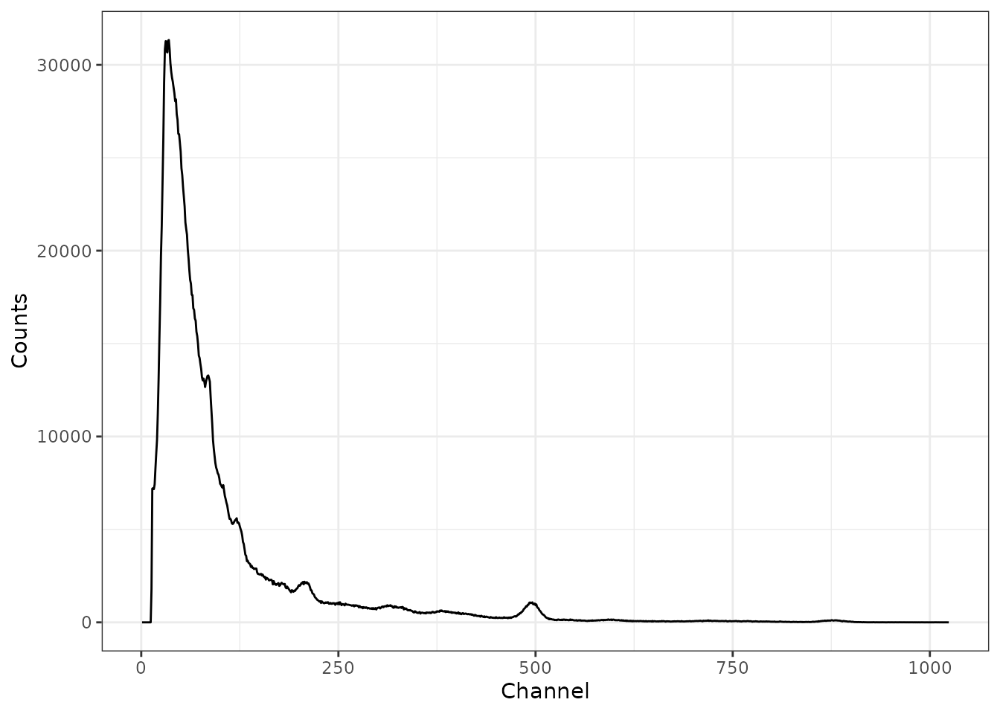
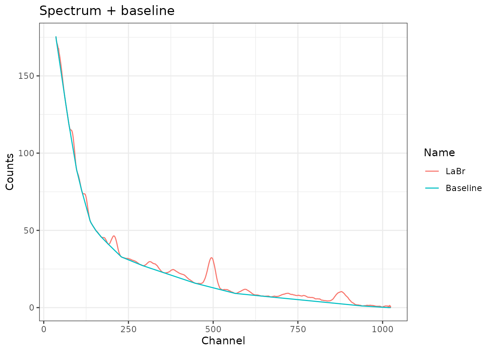
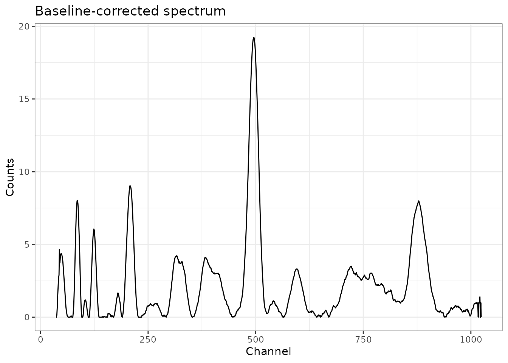
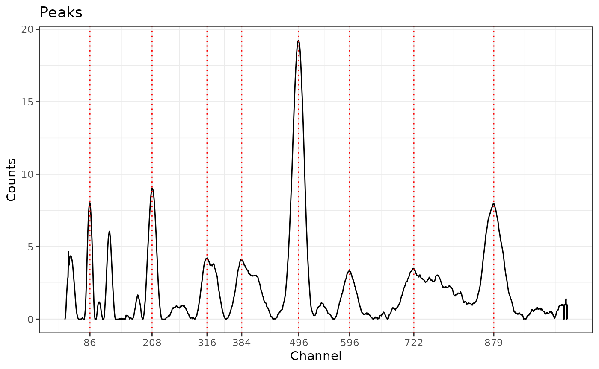
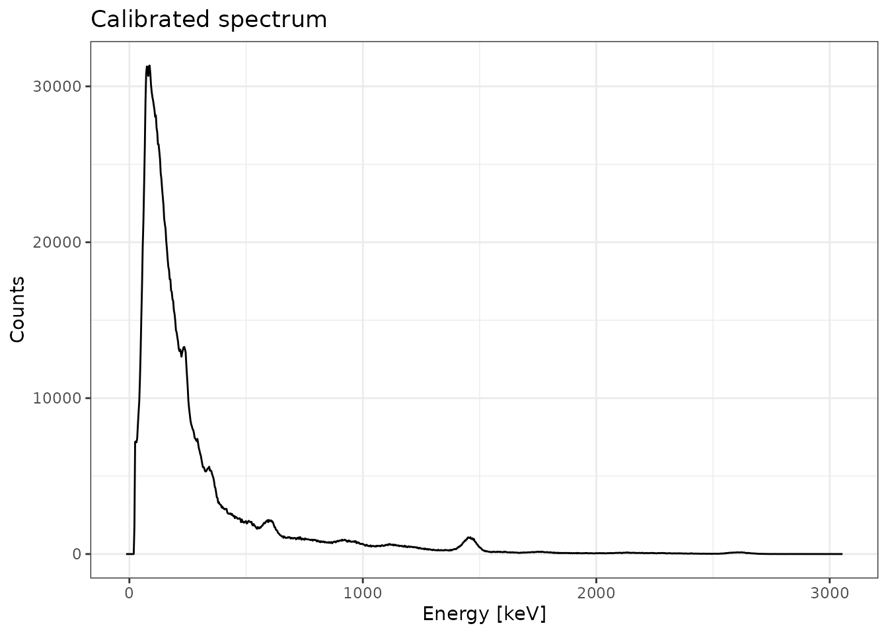
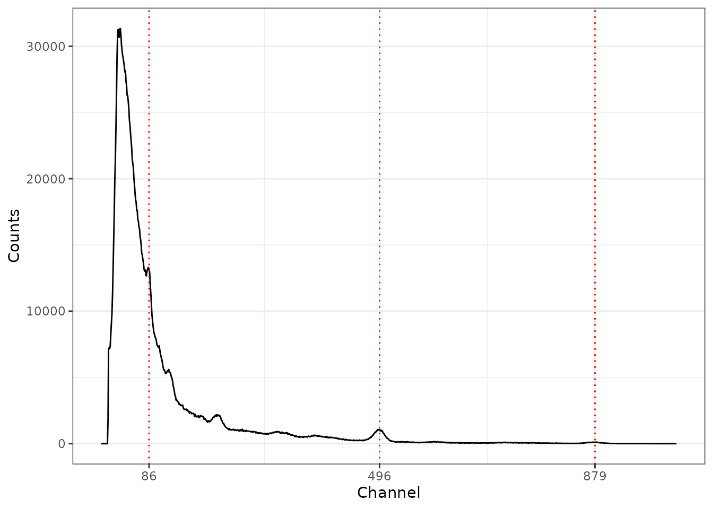

# Introduction to gamma

``` r

library(gamma)
```

## Overview

**gamma** is intended to process in-situ gamma-ray spectrometry
measurements for luminescence dating. This package allows to import,
inspect and (automatically) correct the energy scale of the spectrum. It
provides methods for estimating the gamma dose rate by the use of a
calibration curve. This package only supports Canberra CNF and TKA
files.

Typical workflow:

1.  Import spectrum data with
    [`read()`](https://crp2a.github.io/gamma/reference/read.md),
2.  Inspect spectrum with
    [`plot()`](https://crp2a.github.io/gamma/reference/plot.md),
3.  Calibrate the energy scale with
    [`energy_calibrate()`](https://crp2a.github.io/gamma/reference/energy.md),
4.  Estimate the gamma dose rate with
    [`dose_predict()`](https://crp2a.github.io/gamma/reference/doserate.md).

The estimation of the gamma dose rate requires a calibration curve. This
package contains several built-in curves, but as these are
instrument-specific you may need to build your own (see
[`help(dose_fit)`](https://crp2a.github.io/gamma/reference/doserate.md)).
These built-in curves are in use in several labs and can be used to
reproduce published results. Check out the dedicated vignette for an
overview of the fitting process:
[`vignette("doserate")`](https://crp2a.github.io/gamma/articles/doserate.md)

Note that **gamma** uses the *International System of Units*: energy
values are assumed to be in keV and dose rates in µGy/y.

## Import file

Both Canberra CNF and TKA files can be imported.

``` r

# Automatically skip the first channels
# Import a CNF file
cnf_test <- system.file("extdata/LaBr.CNF", package = "gamma")
(spc_cnf <- read(cnf_test))
#> Gamma spectrum:
#> *  name: LaBr
#> *  date: 2019-02-07 11:48:18
#> *  live_time: 3385.54
#> *  real_time: 3403.67
#> *  channels: 1024
#> *  energy_min: -7
#> *  energy_max: 3124.91

# Import a TKA file
tka_test <- system.file("extdata/LaBr.TKA", package = "gamma")
(spc_tka <- read(tka_test))
#> Gamma spectrum:
#> *  name: LaBr
#> *  date: 2026-10-23 11:09:31.401018
#> *  live_time: 3385.54
#> *  real_time: 3403.67
#> *  channels: 1024
#> *  energy_min: NA
#> *  energy_max: NA

# Import all files in a given directory
files_test <- system.file("extdata", package = "gamma")
(spc <- read(files_test))
#> A collection of 4 gamma spectra: BEGe, Kromek_CZT, LaBr, LaBr
```

## Inspect spectrum

``` r

# Plot CNF spectrum
plot(spc_cnf) +
  ggplot2::theme_bw()
```



## Calibrate the energy scale

The energy calibration of a spectrum is the most tricky part. To do
this, you must specify the position of at least three observed peaks and
the corresponding energy value (in keV).

The package allows you to provide the channel-energy pairs you want to
use. However, the spectrum can be noisy so it is difficult to properly
determine the peak channel. In this case, a better approach may be to
pre-process the spectrum (variance-stabilization, smoothing and baseline
correction) and perform a peak detection. Once the identified peaks are
satisfactory, you can set the corresponding energy values (in keV) and
use these lines to calibrate the energy scale of the spectrum.

Regardless of the approach you choose, it is strongly recommended to
check the result before proceeding.

### Workflow

The following steps illustrate how to properly fine-tune the parameters
for spectrum processing before peak detection.

#### Clean

Several channels can be dropped to retain only part of the spectrum. If
no specific value is provided, an attempt is made to define the number
of channels to skip at the beginning of the spectrum. This drops all
channels before the highest count maximum. This is intended to deal with
the artefact produced by the rapid growth of random background noise
towards low energies.

``` r

# Use a square root transformation
sliced <- signal_slice(spc_tka)
```

#### Stabilization

The stabilization step aims at improving the identification of peaks
with a low signal-to-noise ratio. This particularly targets higher
energy peaks.

``` r

# Use a square root transformation
transformed <- signal_stabilize(sliced, f = sqrt)
```

#### Smoothing

``` r

# Use a 21 point Savitzky-Golay-Filter to smooth the spectrum
smoothed <- signal_smooth(transformed, method = "savitzky", m = 21)
```

#### Baseline correction

The baseline estimation is performed using the SNIP algorithm (Ryan et
al. 1988; Morháč et al. 1997; Morháč and Matoušek 2008). You can apply
the LLS operator to your data, use a decreasing clipping window or
change the number of iterations (see references).

``` r

# Estimate the baseline of a single file
baseline <- signal_baseline(smoothed, method = "SNIP", decreasing = TRUE)

# Plot spectrum + baseline
plot(smoothed, baseline) +
  ggplot2::labs(title = "Spectrum + baseline") +
  ggplot2::theme_bw()
```



``` r

# Substract the estimated baseline
corrected <- smoothed - baseline
# Or, remove the baseline in one go
# corrected <- removeBaseline(smoothed)

# Plot the corrected spectrum
plot(corrected) +
  ggplot2::labs(title = "Baseline-corrected spectrum") +
  ggplot2::theme_bw()
```



``` r

# You can remove the baseline of multiple spectra in one go
# Note that the same parameters will be used for all spectra
clean <- signal_correct(spc)
```

#### Peak detection

Once you have a baseline-corrected spectrum, you can try to
automatically find peaks in the spectrum. A local maximum has to be the
highest one in the given window and has to be higher than $`k`$ times
the noise to be recognized as peak.

``` r

# Detect peaks in a single file
peaks <- peaks_find(corrected)

# Plot spectrum + peaks
plot(corrected, peaks) +
  ggplot2::labs(title = "Peaks") +
  ggplot2::theme_bw()
```



#### Energy scale calibration

If you know the correspondence between several channels and the energy
scale, you can use these pairs of values to calibrate the spectrum. A
second order polynomial model is fitted on these energy *vs* channel
values, then used to predict the new energy scale of the spectrum.

You can use the results of the peak detection and set the expected
energy values.

``` r

# Set the energy values (in keV)
set_energy(peaks) <- c(238, NA, NA, NA, 1461, NA, NA, 2615)
peaks
#> 3 peaks were detected.

# Calibrate the spectrum using the peak positions
scaled <- energy_calibrate(spc_tka, peaks)

# Plot the spectrum
plot(scaled, xaxis = "energy") +
  ggplot2::labs(title = "Calibrated spectrum") +
  ggplot2::theme_bw()
```



Alternatively, you can do it by hand:

``` r

# Create a list of channel-enegy pairs
calib_lines <- list(
  channel = c(84, 492, 865),
  energy = c(238, 1461, 2615)
)

# Calibrate the spectrum using these fixed lines
scaled2 <- energy_calibrate(spc_tka, lines = calib_lines)
```

### Use the pipe!

``` r

# Spectrum pre-processing and peak detection
pks <- spc_tka |>
  signal_slice() |>
  signal_stabilize(f = sqrt) |>
  signal_smooth(method = "savitzky", m = 21) |>
  signal_correct(method = "SNIP", decreasing = TRUE, n = 100) |>
  peaks_find()

# Set the energy values (in keV)
set_energy(pks) <- c(238, NA, NA, NA, 1461, NA, NA, 2615)

# Calibrate the energy scale
cal <- energy_calibrate(spc_tka, pks)

# Plot spectrum
plot(cal, pks) +
  ggplot2::theme_bw()
```



## Estimate the gamma dose rate

To estimate the gamma dose rate, you can either use one of the
calibration curves distributed with this package or build your own.

``` r

# Load one of the built-in curves
data(BDX_LaBr_1) # IRAMAT-CRP2A (Bordeaux)
data(AIX_NaI_1) # CEREGE (Aix-en-Provence)
```

The construction of a calibration curve requires a set of reference
spectra for which the gamma dose rate is known and a background noise
measurement. First, each reference spectrum is integrated over a given
interval, then normalized to active time and corrected for background
noise. The dose rate is finally modelled by the integrated signal value
used as a linear predictor.

See `vignette(doserate)` for a reproducible example.

## References

Morháč, Miroslav, Ján Kliman, Vladislav Matoušek, Martin Veselský, and
Ivan Turzo. 1997. “Background Elimination Methods for Multidimensional
Coincidence Γ-Ray Spectra.” *Nuclear Instruments and Methods in Physics
Research Section A: Accelerators, Spectrometers, Detectors and
Associated Equipment* 401 (1): 113–32.
<https://doi.org/10.1016/S0168-9002(97)01023-1>.

Morháč, Miroslav, and Vladislav Matoušek. 2008. “Peak Clipping
Algorithms for Background Estimation in Spectroscopic Data.” *Applied
Spectroscopy* 62 (1): 91–106.
<https://doi.org/10.1366/000370208783412762>.

Ryan, C. G., E. Clayton, W. L. Griffin, S. H. Sie, and D. R. Cousens.
1988. “SNIP, a Statistics-Sensitive Background Treatment for the
Quantitative Analysis of Pixe Spectra in Geoscience Applications.”
*Nuclear Instruments and Methods in Physics Research Section B: Beam
Interactions with Materials and Atoms* 34 (3): 396–402.
<https://doi.org/10.1016/0168-583X(88)90063-8>.
