# Obtaining a Dose Rate Calibration Curve

## Scope

This vignette walks you through the steps to obtain a calibration curve
for the gamma dose rate prediction. You will need the calibration curve
to calculate the gamma dose rate from spectra measured in the field
where the true gamma dose is yet to be determined. In other words, you
will need this curve to analyse your field data.

## Load library and import files

First things first, let’s load the **gamma** package.

``` r

library(gamma)
```

Now, we will use already measured spectra shipped with **gamma** for
this example. If you determine your calibration curve, you will need to
use your own data. All data used here were measured with a NaI probe.

``` r

## Import CNF files for calibration
spc_dir <- system.file("extdata/AIX_NaI_1/calibration", package = "gamma")
spc <- read(spc_dir)
spc
#> A collection of 5 gamma spectra: BRIQUE, C341, C347, GOU, PEP

## Import a CNF file of background measurement
bkg_dir <- system.file("extdata/AIX_NaI_1/background", package = "gamma")
bkg <- read(bkg_dir)
bkg
#> Gamma spectrum:
#> *  name: PB
#> *  date: 2019-03-27 12:06:02
#> *  live_time: 7707.42
#> *  real_time: 7714.93
#> *  channels: 1024
#> *  energy_min: -7
#> *  energy_max: 3124.91
```

The object `spc` is a set of spectra measured in settings around
Clermont-Ferrand (Miallier et al. 2009) and Bordeaux (Richter et al.
2010) with a known gamma dose rate, where `bgk` is a background curve
measured in a lead castle.

## Energy scale calibration

Before we can further work with the spectra, we have to perform an
energy calibration, this is assigning values in terms of energy to the
channel numbers.

### Reference Spectra

First, we remove the baseline from the set of spectra for easier peak
detection. , in the following subsections, we perform and apply the
energy calibration to each spectrum, including the background spectrum.
One subsection for each spectrum with the corresponding R code.

``` r

## Spectrum pre-processing
## Remove baseline for peak detection
bsl <- spc |>
  signal_slice(-1:-40) |>
  signal_stabilize(f = sqrt) |>
  signal_smooth(method = "savitzky", m = 21) |>
  signal_correct()
```

#### BRIQUE

``` r

## Peak detection
pks <- peaks_find(bsl[["BRIQUE"]])

## Set energy values
set_energy(pks) <- c(238, NA, NA, NA, 1461, NA, NA, 2615)

## Adjust the energy scale
BRIQUE <- energy_calibrate(spc[["BRIQUE"]], pks)
```


#### C341

``` r

## Spectrum pre-processing and peak detection
pks <- peaks_find(bsl[["C341"]])

## Set energy values
set_energy(pks) <- c(238, NA, NA, NA, 1461, NA, 2615)

## Adjust the energy scale
C341 <- energy_calibrate(spc[["C341"]], pks)
```

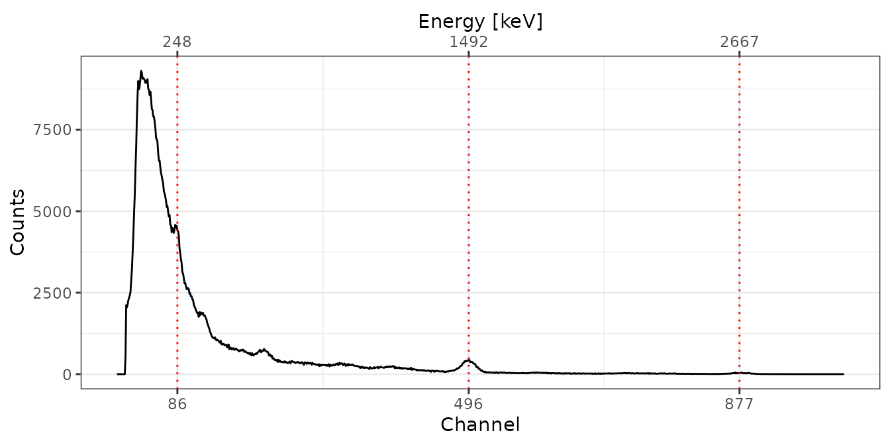

#### C347

``` r

## Spectrum pre-processing and peak detection
pks <- peaks_find(bsl[["C347"]], span = 10)

## Set energy values
set_energy(pks) <- c(238, NA, NA, NA, NA, 1461, NA, 2615)

## Adjust the energy scale
C347 <- energy_calibrate(spc[["C347"]], pks)
```

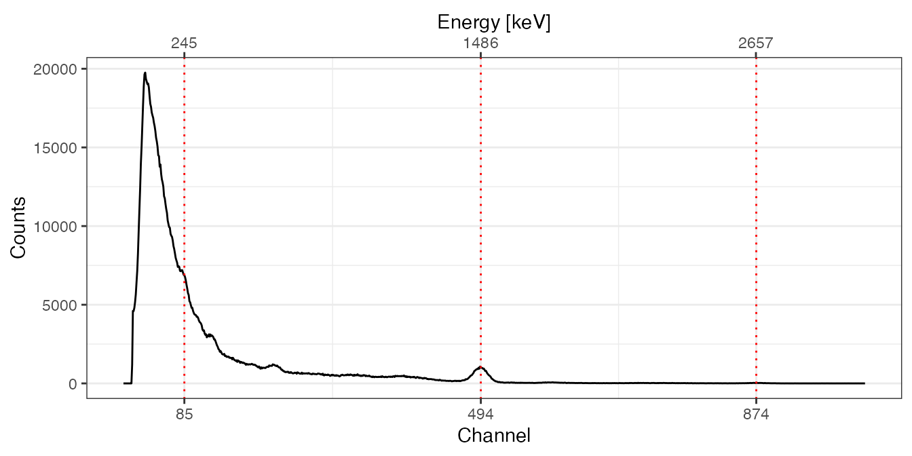

#### GOU

``` r

## Spectrum pre-processing and peak detection
pks <- peaks_find(bsl[["GOU"]])

## Set energy values
set_energy(pks) <- c(238, NA, NA, NA, 1461, NA, NA, 2615)

## Adjust the energy scale
GOU <- energy_calibrate(spc[["GOU"]], pks)
```

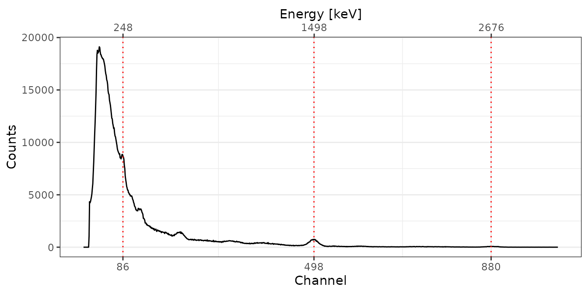

#### PEP

``` r

## Spectrum pre-processing and peak detection
pks <- peaks_find(bsl[["PEP"]])

## Set energy values
set_energy(pks) <- c(238, NA, NA, NA, 1461, NA, NA, 2615)

## Adjust the energy scale
PEP <- energy_calibrate(spc[["PEP"]], pks)
```


#### Background Spectrum

``` r

# Pb212, K40, Tl208
lines <- data.frame(
  channel = c(86, 496, 870),
  energy = c(238, 1461, 2615)
) 
bkg_scaled <- energy_calibrate(bkg, lines = lines)
```

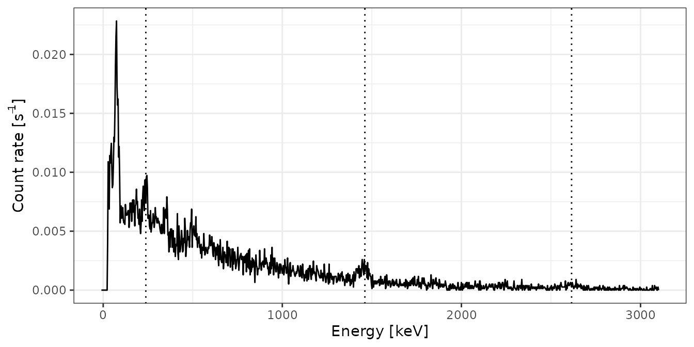

### Signal integration

Two methods can be used to calculate a gamma dose rate from the measured
counts: the ‘window’ method and the ‘threshold’ method. The ‘window’
method compares counts under nuclide-specific gamma-ray peaks to  
reference spectra where the nuclide concentration is known. In this
case, only a small part of the spectrum is used. The ‘threshold’ method
uses the circumstance that above a certain threshold, the number of
counts for a given dose rate changes only slightly with the emitters
(e.g., U, Th, K – cf. Guérin et al. 2011; Mercier and Falguères 2007;
Løvborg and Kirkegaard 1974).

The exact position of this threshold depends on the used probe and needs
to be determined either by modelling or measurements of different sites
with known but different radionuclides concentrations.

For this example (and in the package **gamma** in general), we will
focus solely on the ‘threshold’ method, a crucial tool used to derive a
calibration curve and derive gamma dose rates. This method’s practical
application in deriving a calibration curve is a key aspect of our
exploration. Our first step is to combine the energy-calibrated spectra
into a unified set, laying the foundation for the subsequent
calculations.

``` r

spc_scaled <- list(BRIQUE, C341, C347, GOU, PEP)
spc_scaled <- methods::as(spc_scaled, "GammaSpectra")
spc_scaled
#> A collection of 5 gamma spectra: BRIQUE, C341, C347, GOU, PEP
```

Now we can integrate the spectra using either the cumulative count
spectra or the energy corresponding to a certain energy (cf. Guérin et
al. 2011 for details).

The following two subsections show how to derive the integrated
spectrometer response with each technique. In both cases, however, we
assume that the **threshold itself is already known**! The examples are
for educational reasons only and the here used function
[`signal_integrate()`](https://crp2a.github.io/gamma/dev/reference/integrate.md)
is used in the back by the function
[`dose_fit()`](https://crp2a.github.io/gamma/dev/reference/doserate.md)
we will use later to derive the calibration curve.

#### Using the count threshold

``` r

## Integration range (in keV)
Ni_range <- c(200, 2800)

## Integrate background spectrum
Ni_bkg <- signal_integrate(
  object = bkg_scaled, 
  range = Ni_range, 
  energy = FALSE)

## Integrate reference spectra
Ni_spc <- signal_integrate(
  object = spc_scaled, 
  range = Ni_range, 
  background = Ni_bkg, 
  energy = FALSE, 
  simplify = TRUE)
```

#### Using the energy threshold

``` r

## Integration range (in keV)
NiEi_range <- c(200, 2800)

## Integrate background spectrum
NiEi_bkg <- signal_integrate(
  object = bkg_scaled, 
  range = NiEi_range, 
  energy = TRUE)

## Integrate reference spectra
NiEi_signal <- signal_integrate(
  object = spc_scaled, 
  range = NiEi_range, 
  background = NiEi_bkg, 
  energy = TRUE,
  simplify = TRUE)
```

### Get dose rate calibration curve

The dose rate calibration curve models detector specific counts against
a know gamma-dose so that such gamma dose can be derived from unknown
spectra with the the same detector.

#### Model calibration curve

To model the calibration curve we will need have measured sites with
known radionuclide concentrations. `'gamma'` ships a table with values
from know sites in the dataset `clermont`. If you, as we have, measured
with your probe in that locations you do not have to manually add values
from Miallier et al. (2009) or Richter et al. (2010).

``` r

## Get reference dose rates
data("clermont")
doses <- clermont[, c("gamma_dose", "gamma_error")]
```

|  | name | laboratory | nature | U | U_error | Th | Th_error | K2O | K2O_error | K | K_error | gamma_dose | gamma_error | cosmic_dose | cosmic_error |
|:---|:---|:---|:---|---:|---:|---:|---:|---:|---:|---:|---:|---:|---:|---:|---:|
| BRIQUE | BRIQUE | Bordeaux | ceramic | 4.10 | 0.15 | 13.70 | 0.40 | NA | NA | 3.500000 | 0.100000 | 1986.4620 | 35.619679 | 152 | 6 |
| C341 | C341 | Clermont-Ferrand | trachybasalt | 1.80 | 0.05 | 6.42 | 0.40 | 1.65 | 0.03 | 1.369665 | 0.024903 | 849.9668 | 21.317615 | 170 | 15 |
| C347 | C347 | Clermont-Ferrand | granite | 2.84 | 0.12 | 4.67 | 0.10 | 4.27 | 0.10 | 3.544527 | 0.083010 | 1423.8589 | 25.249756 | 170 | 15 |
| GOU | GOU | Clermont-Ferrand | trachyandesite | 3.18 | 0.12 | 11.95 | 0.06 | 3.13 | 0.04 | 2.598213 | 0.033204 | 1575.2249 | 17.433789 | 110 | 15 |
| LAS | LAS | Clermont-Ferrand | basalt | 2.14 | 0.04 | 7.57 | 0.15 | 2.33 | 0.02 | 1.934133 | 0.016602 | 1083.6737 | 9.570593 | 120 | 20 |
| LMP | LMP | Clermont-Ferrand | basalt | 1.60 | 0.14 | 5.91 | 0.09 | 0.87 | 0.03 | 0.722187 | 0.024903 | 641.9004 | 17.560649 | 120 | 20 |
| MAZ | MAZ | Clermont-Ferrand | trachyandesite | 2.39 | 0.08 | 8.58 | 0.04 | 2.24 | 0.03 | 1.859424 | 0.024903 | 1141.4033 | 11.665045 | 200 | 20 |
| MPX | MPX | Clermont-Ferrand | sandstone | 1.38 | 0.03 | 3.61 | 0.20 | 3.08 | 0.04 | 2.556708 | 0.033204 | 964.0196 | 13.274167 | 110 | 15 |
| PEP | PEP | Clermont-Ferrand | granite | 6.00 | 0.20 | 19.00 | 2.00 | 4.63 | 0.24 | 3.843363 | 0.199224 | 2538.2217 | 112.169131 | 140 | 20 |

In the next step we create a list with additional information about the
used equipment to be passed onto the calibration R object. You have to
modify those values for your own detector.

``` r

## Metadata
info <- list(
  laboratory = "CEREGE",
  instrument = "InSpector 1000",
  detector = "NaI",
  authors = "CEREGE Luminescence Team"
)
```

In the last step we construct the calibration curve and inspect the
results.

``` r

## Build the calibration curve
AIX_NaI <- dose_fit(
  object = spc_scaled, 
  background = bkg_scaled, 
  doses = doses,
  range_Ni = Ni_range, 
  range_NiEi = NiEi_range,
  details = info
)
AIX_NaI 
#> Calibration curve:
#> * laboratory: CEREGE
#> * instrument: InSpector 1000
#> * detector: NaI
#> * authors: CEREGE Luminescence Team
#> * date: 2026-05-04 13:45:57.126514
#> * energy_calibration: <5 available>
```

If this information seems too opaque , we can further inspect the output
numerically ([`summary()`](https://rdrr.io/r/base/summary.html)) and
graphically using the package
[`plot()`](https://crp2a.github.io/gamma/dev/reference/plot.md) methods.

``` r

## Show summary
summarise(AIX_NaI)
#> $Ni
#> $Ni$residuals
#> [1]  33.573851   7.952809   6.541241 -18.560316  78.345223
#> 
#> $Ni$coefficients
#>            Estimate Std. Error
#> Intercept 40.164150 41.7624590
#> Slope      9.138879  0.2714404
#> 
#> $Ni$MSWD
#> [1] 0.8995128
#> 
#> $Ni$df
#> [1] 3
#> 
#> $Ni$p_value
#> [1] 0.4404757
#> 
#> 
#> $NiEi
#> $NiEi$residuals
#> [1]  33.906847  12.518973 -21.932740  -8.121079  86.161275
#> 
#> $NiEi$coefficients
#>              Estimate   Std. Error
#> Intercept 27.88558657 4.202809e+01
#> Slope      0.01735135 5.142108e-04
#> 
#> $NiEi$MSWD
#> [1] 0.9375135
#> 
#> $NiEi$df
#> [1] 3
#> 
#> $NiEi$p_value
#> [1] 0.4214397
```

``` r

## Plot calibration curves
plot(AIX_NaI, energy = FALSE) +
  ggplot2::theme_bw()
plot(AIX_NaI, energy = TRUE) +
  ggplot2::theme_bw()
```

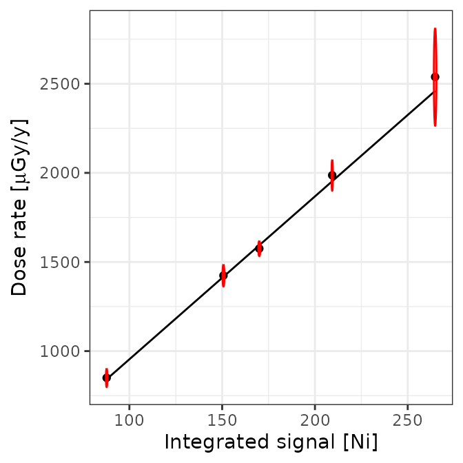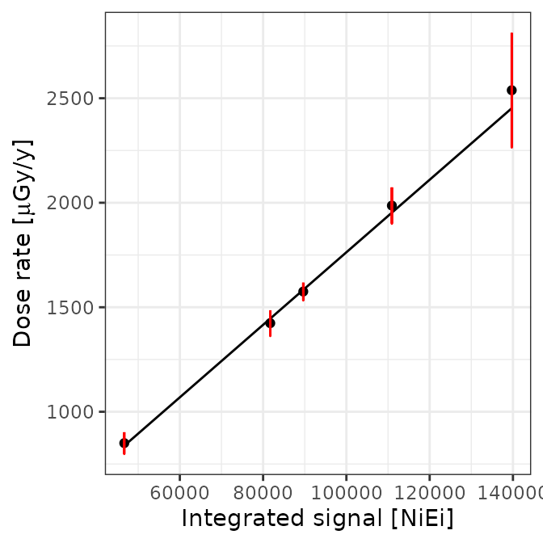

Well, this looks all good and should make a good calibration curve. To
use this calibration curve in the future, you can save the object using
the base R function [`save()`](https://rdrr.io/r/base/save.html).

``` r

save(AIX_NaI, file = "<you_path>/<date>_NaI_DoseRate_Calibration.rda")
```

#### Check the model

Although the calibration curve appears reasonable, we can use a few
additional R plots to further inspect the performed calibration.

##### Count threshold (`Ni`)

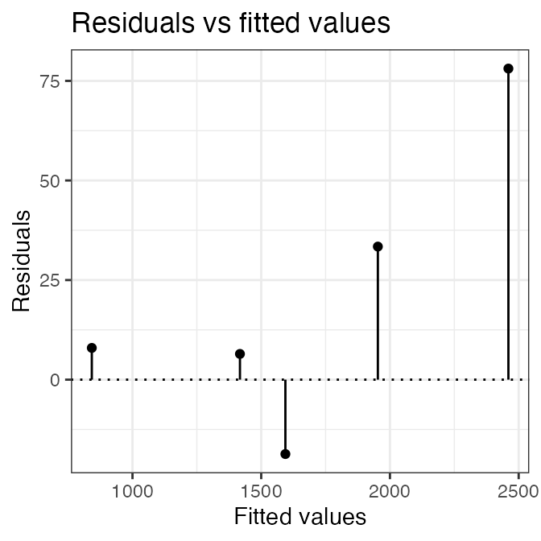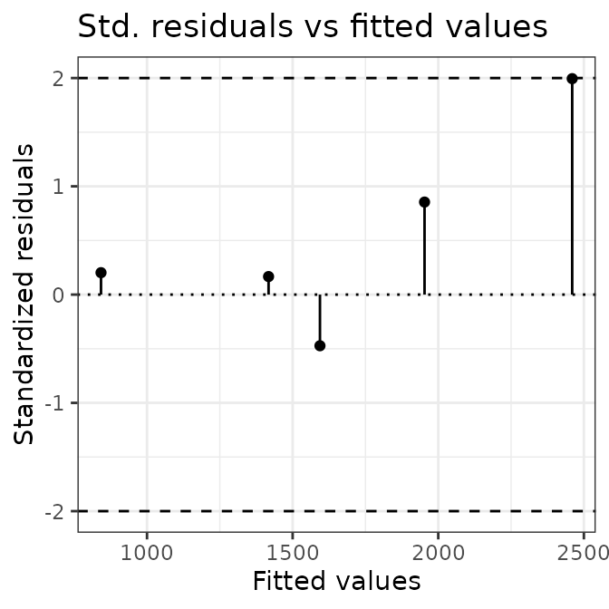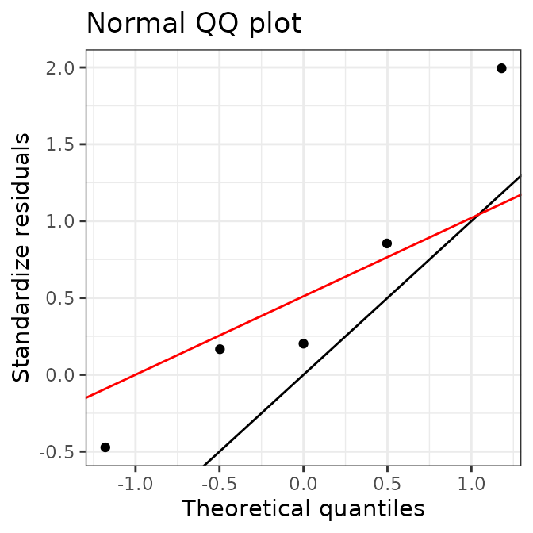

##### Energy threshold (`Ni.Ei`)

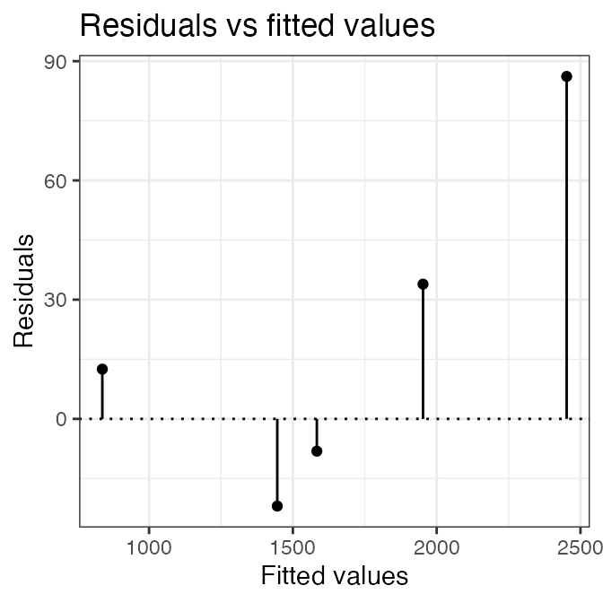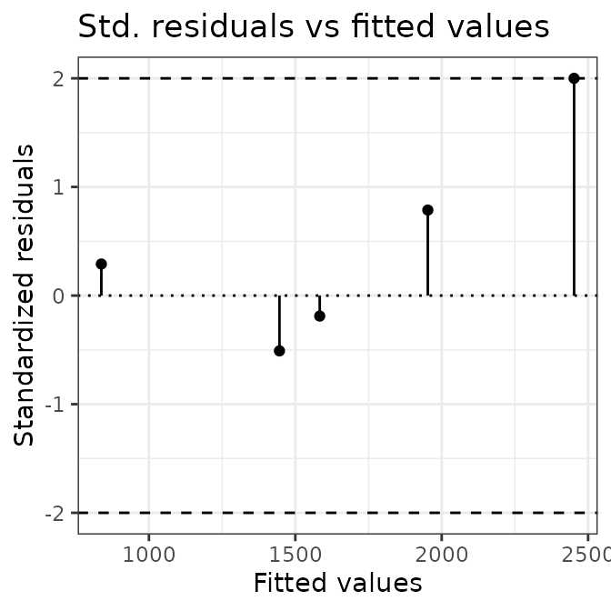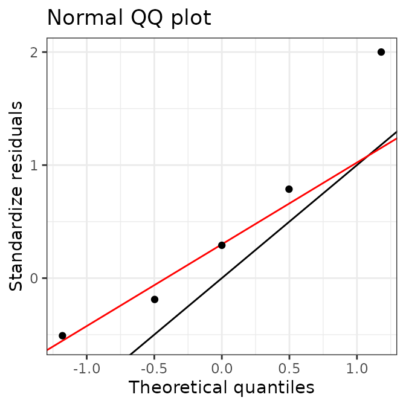

### Application example: predict new dose rates

After calibrating our detector, it is time to derive gamma dose rates
from sites with unknown radionuclide concentrations. As mentioned above,
we will use data we ship with `'gamma'`. Our routine analysis consists
of only three steps:

#### Import measured data

``` r

## Import CNF files for dose rate prediction
test_dir <- system.file("extdata/AIX_NaI_1/test", package = "gamma")
test <- read(test_dir)
```

#### Inspect the spectra

``` r

## Inspect spectra
plot(test, yaxis = "rate") +
  ggplot2::theme_bw()
```

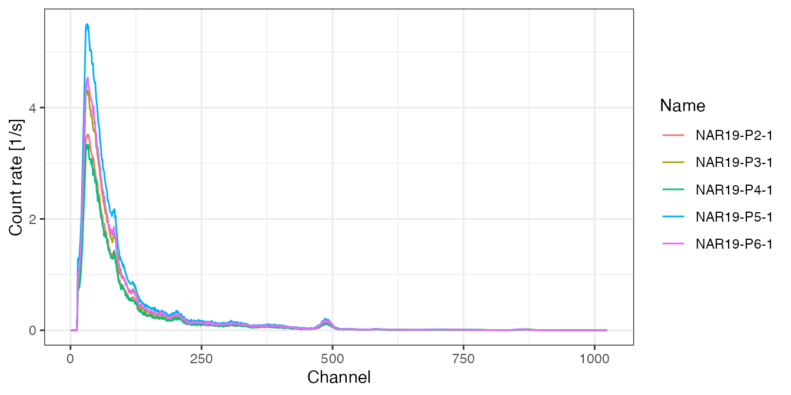

#### Energy calibrate the spectra

``` r

## Pb212, K40, Tl208
pks <- data.frame(
  channel = c(86, 490, 870),
  energy = c(238, 1461, 2615)
)
pks <- as_peaks(pks)

## Energy calibrate
test <- energy_calibrate(test, pks)

## Check the calibration for one curve
plot(test[[1]], pks) +
  ggplot2::theme_bw()
```

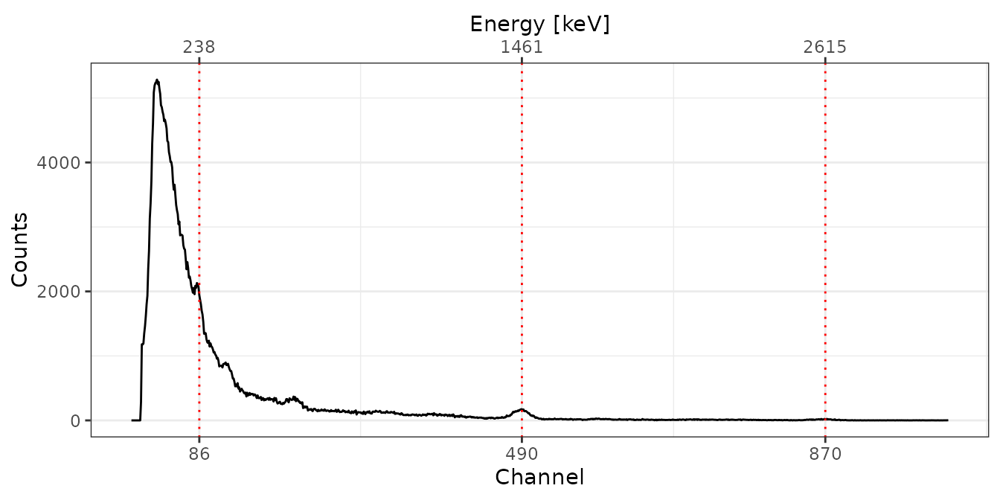

``` r


## Show all energy calibrated spectra 
plot(test, xaxis = "energy", yaxis = "rate") +
  ggplot2::theme_bw()
```

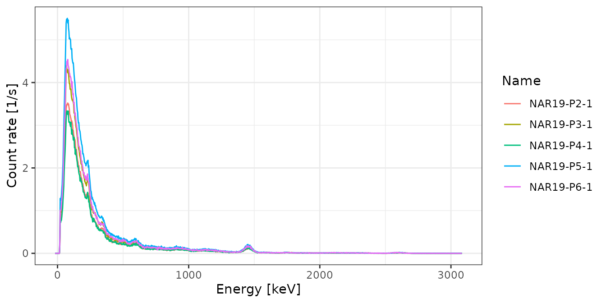

#### Predict the dose rates

``` r

rates <- dose_predict(AIX_NaI, test, sigma = 1.96)
rates
#>         name signal_Ni signal_err_Ni   dose_Ni dose_err_Ni signal_NiEi
#> 1 NAR19-P2-1  90.60172     0.2479502  868.1623    52.24518    47953.18
#> 2 NAR19-P3-1 110.13766     0.2452741 1046.6989    62.96733    58543.44
#> 3 NAR19-P4-1  87.45143     0.2736257  839.3722    50.52866    46393.01
#> 4 NAR19-P5-1 138.48561     0.3079133 1305.7674    78.55221    74020.40
#> 5 NAR19-P6-1 115.97222     0.3587824 1100.0202    66.21719    62016.48
#>   signal_err_NiEi dose_NiEi dose_err_NiEi dose_final dose_err_final
#> 1        5.729871  859.9379      51.58826   864.0501       73.42087
#> 2        5.676295 1043.6933      62.61183  1045.1961       88.79779
#> 3        6.330354  832.8669      49.96429   836.1196       71.05887
#> 4        7.139047 1312.2395      78.72209  1309.0034      111.21021
#> 5        8.323213 1103.9552      66.22706  1101.9877       93.65265
```

*Note: We assume here that the energy scale of each spectrum was
adjusted first.*

## Outro: our R session

Finally, for transparency, the R session setting used for rendering this
vignette:

    #> R version 4.6.0 (2026-04-24)
    #> Platform: x86_64-pc-linux-gnu
    #> Running under: Ubuntu 24.04.4 LTS
    #> 
    #> Matrix products: default
    #> BLAS:   /usr/lib/x86_64-linux-gnu/openblas-pthread/libblas.so.3 
    #> LAPACK: /usr/lib/x86_64-linux-gnu/openblas-pthread/libopenblasp-r0.3.26.so;  LAPACK version 3.12.0
    #> 
    #> locale:
    #>  [1] LC_CTYPE=C.UTF-8       LC_NUMERIC=C           LC_TIME=C.UTF-8       
    #>  [4] LC_COLLATE=C.UTF-8     LC_MONETARY=C.UTF-8    LC_MESSAGES=C.UTF-8   
    #>  [7] LC_PAPER=C.UTF-8       LC_NAME=C              LC_ADDRESS=C          
    #> [10] LC_TELEPHONE=C         LC_MEASUREMENT=C.UTF-8 LC_IDENTIFICATION=C   
    #> 
    #> time zone: UTC
    #> tzcode source: system (glibc)
    #> 
    #> attached base packages:
    #> [1] stats     graphics  grDevices utils     datasets  methods   base     
    #> 
    #> other attached packages:
    #> [1] gamma_1.1.0.9000
    #> 
    #> loaded via a namespace (and not attached):
    #>  [1] vctrs_0.7.3        cli_3.6.6          knitr_1.51         rlang_1.2.0       
    #>  [5] xfun_0.57          rxylib_0.2.14      S7_0.2.2           textshaping_1.0.5 
    #>  [9] jsonlite_2.0.0     labeling_0.4.3     glue_1.8.1         htmltools_0.5.9   
    #> [13] ragg_1.5.2         sass_0.4.10        scales_1.4.0       rmarkdown_2.31    
    #> [17] grid_4.6.0         evaluate_1.0.5     jquerylib_0.1.4    fastmap_1.2.0     
    #> [21] yaml_2.3.12        lifecycle_1.0.5    compiler_4.6.0     RColorBrewer_1.1-3
    #> [25] fs_2.1.0           Rcpp_1.1.1-1.1     IsoplotR_6.8       farver_2.1.2      
    #> [29] systemfonts_1.3.2  digest_0.6.39      R6_2.6.1           bslib_0.10.0      
    #> [33] withr_3.0.2        tools_4.6.0        gtable_0.3.6       pkgdown_2.2.0     
    #> [37] ggplot2_4.0.3      cachem_1.1.0       desc_1.4.3

## References

Guérin, G., N. Mercier, and G. Adamiec. 2011. “Dose-Rate Conversion
Factors: Update.” *Ancient TL* 29 (1): 5–8.

Løvborg, Leif, and Peter Kirkegaard. 1974. “Response of 3$`{''}`$
3$`{''}`$ NaI(Tl) Detectors to Terrestrial Gamma Radiation.” *Nuclear
Instruments and Methods* 121 (2): 239–51.
<https://doi.org/10.1016/0029-554x(74)90072-x>.

Mercier, N., and C. Falguères. 2007. “Field Gamma Dose-Rate Measurement
with a NaI(Tl) Detector: Re-Evaluation of the "Threshold" Technique.”
*Ancient TL* 25 (1): 1–4.

Miallier, D., G. Guérin, N. Mercier, T. Pilleyre, and S. Sanzelle. 2009.
“The Clermont Radiometric Reference Rocks: A Convenient Tool for
Dosimetric Purposes.” *Ancient TL* 27 (2): 37–44.

Richter, Daniel, H Dombrowski, S Neumaier, P Guibert, and A C Zink.
2010. “Environmental Gamma Dosimetry with OSL of -Al2O3:C for in Situ
Sediment Measurements.” *Radiation Protection Dosimetry* 141 (1): 27–35.
<https://doi.org/10.1093/rpd/ncq146>.
